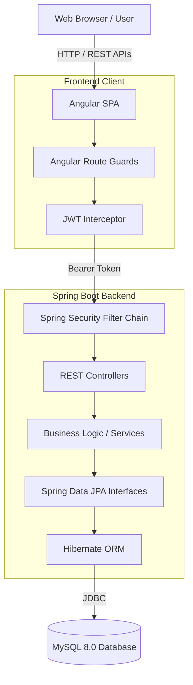
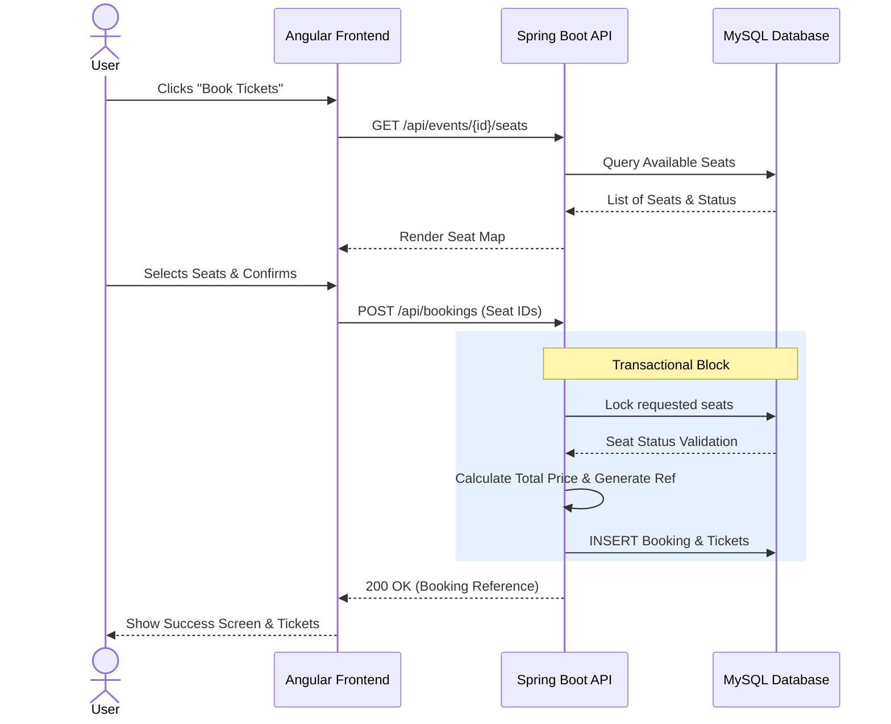
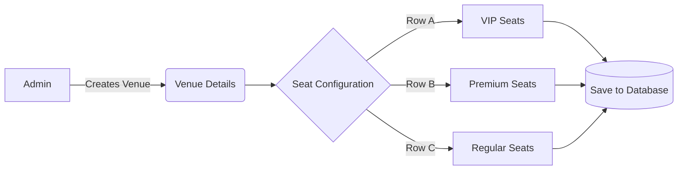

# VenueVista — EventPro Ticketing & Venue Management System


VenueVista is a full-stack, enterprise-grade event ticketing and venue management platform. It provides a seamless experience for end-users to browse events, select seats, and book tickets, while offering powerful administrative tools for venue configuration, seat mapping, and real-time sales analytics.

---

## 🎯 Features

### For Users
- **Secure Authentication:** JWT-based login and registration.
- **Event Discovery:** Browse upcoming events with details, pricing, and venue information.
- **Interactive Seat Mapping:** Select specific seats from a dynamically generated visual layout map (VIP, Premium, Regular).
- **Ticket Management:** View booking history, active tickets, and status.

### For Administrators
- **Real-Time Dashboard:** View total revenue, tickets sold, and recent booking transactions.
- **Venue Configuration:** Create venues and visually map out exact seating charts/rows.
- **Event Management:** Schedule events, assign them to venues, and define categories.
- **Sales Analytics:** Track event-wise performance, ticket sales, and revenue breakdown.

---

## 🏗️ System Architecture

VenueVista follows a strict client-server architecture with stateless authentication. 



---

## 🔄 Core Workflows

### 1. Interactive Booking Flow
The core logic of VenueVista revolves around guaranteeing seat uniqueness and preventing double-booking during high concurrency.



### 2. Administrator Venue Creation


---

## 💻 Tech Stack

**Frontend:**
- **Framework:** Angular 17 (Standalone Components)
- **Styling:** Custom Vanilla CSS Grid / Flexbox (Flat Minimal UI Design System)
- **Routing:** Angular Router with AuthGuards
- **State:** RxJS Observables & Signals

**Backend:**
- **Framework:** Spring Boot 3.2 (Java 17)
- **Security:** Spring Security 6 + JJWT (JSON Web Tokens)
- **ORM:** Hibernate + Spring Data JPA
- **Database:** MySQL 8.0

**DevOps & CI/CD:**
- **Pipeline:** GitHub Actions (Automated Build & Test)
- **Services:** Integrated MySQL Docker container for CI testing
- **Build Tool:** Maven (Backend) / NPM (Frontend)

---

## 🚀 Getting Started

### Prerequisites
- Node.js 18.x or higher
- Java 17 (JDK 17)
- MySQL 8.0 (or XAMPP)

### 1. Database Setup
1. Open your MySQL client (or phpMyAdmin) and create the database:
   ```sql
   CREATE DATABASE venuevista;
   ```
2. The application is configured to automatically create tables (`ddl-auto=update`).
3. *(Optional)* A `DataSeeder` class in the backend will automatically inject a default Admin account, Venues, and Events upon first boot if the database is empty.

### 2. Backend Setup
1. Navigate to the backend directory:
   ```bash
   cd backend
   ```
2. Build the project:
   ```bash
   ./mvnw clean package
   ```
3. Run the Spring Boot server:
   ```bash
   ./mvnw spring-boot:run
   ```
   *The backend will run on `http://localhost:8080`*

### 3. Frontend Setup
1. Open a new terminal and navigate to the frontend directory:
   ```bash
   cd frontend
   ```
2. Install dependencies:
   ```bash
   npm install
   ```
3. Start the Angular development server:
   ```bash
   npm run start
   ```
   *The frontend will be accessible at `http://localhost:4200`*

---

## 🔐 Default Test Credentials
If the database was seeded automatically upon startup, you can use the following credentials:

| Role | Email | Password |
|------|-------|----------|
| **Admin** | `admin@venuevista.com` | `Admin@123` |
| **User** | `user@venuevista.com` | `User@123` |

---

## 🛡️ CI/CD Pipelines
This repository contains two dedicated GitHub Action workflows located in `.github/workflows`:
1. **Frontend CI (`frontend-ci.yml`)**: Installs Node, runs `npm ci`, and executes a production Angular build (`npm run build`).
2. **Backend CI (`backend-ci.yml`)**: Spins up a headless MySQL 8.0 service container, builds the Java binaries via Maven, and executes integration tests.

---

## 📄 Reports & Documentation
Detailed project documentation and presentation materials are available in the `reports/` directory:

- 📊 **[Project Presentation (PDF)](reports/HCL%20Project%20VenueVista.pptx.pdf)** — Visual overview, architecture, and feature showcase of VenueVista.
- 📋 **[Software Requirements Specification (SRS)](reports/VenueVista_SRS_Report.docx)** — Comprehensive technical requirements, use-cases, and functional specifications.
